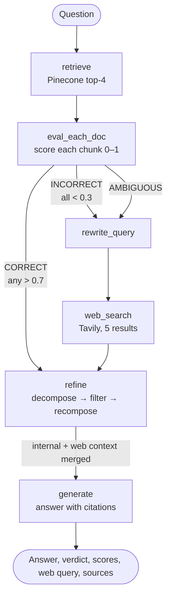

# Corrective RAG (CRAG)

A single-file Corrective RAG pipeline over four PDF books, built with LangGraph,
Gemini, local Ollama embeddings, Pinecone and Tavily. It re-implements the six
CampusX [corrective-rag](https://github.com/campusx-official/corrective-rag)
notebooks with current, non-deprecated APIs.

## What is CRAG?

Plain RAG trusts whatever the retriever returns. **Corrective RAG** checks it first:

1. A **retrieval evaluator** scores every retrieved chunk for relevance (0 to 1).
2. Based on those scores, the run gets one of three verdicts:
   - **CORRECT**: at least one chunk scores above 0.7. Use the good internal chunks.
   - **INCORRECT**: every chunk scores below 0.3. Ignore them and search the web.
   - **AMBIGUOUS**: anything in between. Use the partially relevant chunks **and** the web.
3. **Knowledge refinement** (decompose, filter, recompose) splits the context into
   sentence strips, keeps only the relevant ones and stitches them back together.
4. Before searching the web, the question is **rewritten** into a keyword query.
5. The answer is generated **only** from the refined context, with citations
   (`file.pdf p.N` or a URL). If the context is not enough, the answer says so.

## Architecture



The refine step uses different inputs for each verdict: CORRECT uses the good PDF
chunks, INCORRECT uses the web results, and AMBIGUOUS uses both, merged into
labelled *Internal knowledge* and *Web knowledge* sections.

| Stage (CampusX notebook) | Where in `crag.py` |
|---|---|
| 1. Basic RAG | `NomicEmbeddings`, `ensure_index`, `ingest`, `retrieve`, `generate` |
| 2. Retrieval refinement | `decompose`, `filter_strips`, `recompose`, `refine` |
| 3. Retrieval evaluator | `DocEvalScore`, `eval_each_doc` (`UPPER_TH`, `LOWER_TH`) |
| 4. Web search fallback | `web_search` (Tavily) |
| 5. Query rewrite | `WebQuery`, `rewrite_query` |
| 6. Ambiguous | `route_after_eval`, the merged sections in `refine` |

**Stack**

| Part | Choice |
|---|---|
| LLM | `gemini-3.5-flash-lite`, with `gemini-3.8-flash` as fallback, via `langchain-google-genai` |
| Embeddings | `nomic-embed-text` (768-d) via Ollama, with `search_document:` / `search_query:` prefixes |
| Vector DB | Pinecone serverless index `crag-docs` (cosine), namespace `books` |
| Web search | `TavilySearch` from `langchain-tavily` |
| Orchestration | LangGraph `StateGraph` with conditional edges |
| Graders / rewriter / filter | `llm.with_structured_output(PydanticModel)` |
| UI | Streamlit |

## Setup

Prerequisites: [uv](https://docs.astral.sh/uv/) and [Ollama](https://ollama.com).

```bash
# 1. Embedding model (one time, ~274 MB)
ollama pull nomic-embed-text

# 2. Dependencies
uv sync

# 3. Keys
cp .env.example .env    # then fill in GEMINI_API_KEY, TAVILY_API_KEY, PINECONE_API_KEY

# 4. Build the index (creates the Pinecone index if needed; skipped if already filled)
uv run crag.py ingest                  # all PDFs in documents/
uv run crag.py ingest --max-pages 2 --namespace smoke   # quick smoke test
uv run crag.py ingest --force          # rebuild the namespace from scratch

# 5. Ask questions
uv run crag.py ask "What is a pandas DataFrame?"
uv run crag.py eval                    # 3 sample questions, one per verdict

# 6. Web UI
uv run streamlit run app.py
```

Optional `.env` settings: `GEMINI_MODEL`, `GEMINI_FALLBACK_MODEL`,
`GEMINI_MAX_ATTEMPTS` (default 6), `PINECONE_NAMESPACE` (default `books`),
`OLLAMA_BASE_URL`.

## Sample questions

| Question | Expected route |
|---|---|
| What is a pandas DataFrame? | CORRECT |
| What is the difference between supervised and unsupervised learning? | CORRECT |
| Explain the Apriori algorithm for frequent itemset mining. | CORRECT |
| Who won the 2026 FIFA World Cup final? | INCORRECT → web |
| Which country hosted the 2024 Summer Olympics? | INCORRECT → web |
| What is the latest stable version of Python and when was it released? | AMBIGUOUS → books + web |

## Project layout

```
crag.py        all logic: config → embeddings → Pinecone → ingest → state → nodes → graph → CLI
app.py         Streamlit UI (chat + "How CRAG answered this" trace)
documents/     the source PDFs
.env.example   key names (copy to .env)
```

## Notes

- **Rate limits:** every Gemini call goes through `llm_batch`, which retries
  429/5xx/timeout errors with exponential backoff and jitter. Only the failed
  items of a batch are retried. Strip filtering is batched (20 strips per call)
  to keep a question to roughly 8–10 LLM calls.
- **Idempotent ingest:** chunk IDs are deterministic hashes, and `ingest` skips
  a namespace that already has vectors unless you pass `--force`.
- **Updated since the CampusX notebooks:** `TavilySearchResults` became
  `langchain_tavily.TavilySearch`; `pinecone.init()` / `pinecone-client` became
  the `Pinecone` client object (SDK v7); OpenAI embeddings became local
  `nomic-embed-text`. `PyPDFLoader` still comes from `langchain-community`,
  which is being sunset, because no standalone replacement exists yet.
- Gemini 3.x Flash-Lite uses fixed sampling, so `temperature=0` has no effect
  on it. It is still passed for models that honour it.
